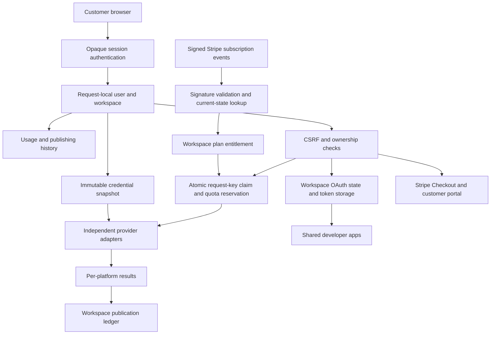

# Dispatch SaaS architecture

Updated November 21, 2026.

## Product boundary

Dispatch is now a single-node SaaS MVP built on FastAPI. User accounts own workspaces. Workspaces own publishing credentials, authorized social accounts, usage, request keys, subscription state and publication history. A shared social developer application belongs to the service operator. Customers authorize their own accounts using that shared application.

The existing assessment endpoint and video adapters remain intact. Tests can explicitly construct legacy Settings, while normal environment startup enables SaaS mode. No cloud deployment or live charge is implied by this conversion.

## Runtime flow

## Components

- app/main.py wires lifespan, shared HTTP client, session/tenant middleware, APIs and static assets.
- app/tenancy.py holds ContextVar identity and workspace selection, set and reset for every request.
- app/saas.py owns authentication, ownership-checked workspaces, usage/history, operator bootstrap, migration encryption and Stripe integration.
- app/manage.py provides console-only administrator promotion.
- app/config.py defines environment defaults and SaaS/billing configuration.
- app/settings_routes.py merges global developer apps with workspace credentials, pins immutable snapshots, validates updates and checks account access without publishing.
- app/services/store.py scopes credentials, accounts, request keys and OAuth states to the request workspace. Settings and OAuth account payloads are encrypted.
- app/services/posting_service.py runs the three text adapters independently.
- app/services/video_accounts.py implements provider authorization and token refresh.
- app/services/video_posting.py implements upload protocols and processing checks.
- app/video_routes.py handles bounded real-file validation, consent and expiring media links.
- app/web/index.html retains the text/video composers and six setup forms.
- app/web/assets/saas.js provides account onboarding, sidebar navigation, workspace switching, overview/history and billing.
- app/web/assets/saas.css supplies the responsive SaaS visual shell.

## Data model

Users store a normalized unique email, display name, password salt/hash and administrator flag. Sessions store only hashes of opaque cookie values, a user ID, active workspace, CSRF token and expiration. Workspaces have an owner, plan, subscription status and unique Stripe customer ID.

Credentials/settings, connected account payloads and request keys use workspace-prefixed keys in the existing tables. Legacy records retain their unscoped keys. OAuth states are selected by both random state and scoped platform. A customer cannot consume another workspace's sign-in state. Workspace IDs come from authenticated sessions and ownership checks, rather than user-provided publishing payloads.

Publications record an immutable request key, kind, title, UTC creation time, status and normalized delivery response. Processing/interrupted rows remain visible. Pending provider processing is preserved as pending. Partial delivery is distinct from complete failure.

Billing-checkout rows retain the active remote session to avoid creating repeated open checkouts. Billing-event IDs provide replay protection. Auth-attempt rows enforce a persisted short-window rate limit.

## Security and migration

Passwords use independent random salts with scrypt. Session tokens are random and stored only as SHA-256 hashes. Cookie lifetime is seven days, with HttpOnly and SameSite=Lax. HTTPS APP_BASE_URL enables Secure. Mutations require the session-bound CSRF header. Origin checks reject foreign-origin browser requests. Trusted-host middleware rejects hostnames outside the operator-configured allowlist.

Matching ADMIN_EMAIL never grants privileges through public signup. The first direct loopback registration can bootstrap a local operator when ADMIN_EMAIL is unset. Public operators promote their registered account through a trusted deployment console.

Fernet protects credential and account payloads at rest. A configured ENCRYPTION_KEY takes precedence. Local setups generate an owner-only master.key. Backups require this key. First migration creates a pre-SaaS database backup before encryption. Old local data stays unassigned, preventing public signups from inheriting the prior operator's accounts.

Shared app credentials are writable only by administrators. Customer setup responses omit shared credential fields. Rotating an app invalidates that provider's saved OAuth connections and outstanding states across workspaces. Text credentials always remain workspace-specific. Customer-configured Mastodon and Bluesky origins must match SOCIAL_ALLOWED_HOSTS. Operators approve additional hosts through the environment. This prevents arbitrary customer-selected internal destinations. Deployment egress controls remain necessary as defense in depth.

Public media links are unguessable bearer capabilities with one-hour validity. Uploaded media must be reachable by Instagram without the browser session. The host filesystem and media capabilities are separate from customer API access.

## Email identity lifecycle

SMTP delivery uses TLS (STARTTLS on port 587 or implicit TLS on 465). Verification tokens expire after 24 hours and password-reset tokens after one hour. Only token hashes are stored. Token consumption and the corresponding account mutation share one transaction. Resetting a password revokes all sessions for that user. Recovery responses do not distinguish unknown accounts from known accounts.

Verification is required by default for HTTPS environment deployments. Required verification fails closed when email delivery has not been configured. Account setup can be prepared while awaiting verification, but publication, provider authorization/testing and checkout are blocked. Local development can use the product without SMTP unless verification is explicitly required. Fragment-based email links avoid placing secret tokens in server request URLs. The frontend exchanges the token through a JSON POST.

## Subscription and usage semantics

Free and Pro limits are operator-configurable per workspace per UTC calendar month. Every new publishing attempt reserves one unit inside the same SQLite transaction as request-key insertion. Failed and interrupted attempts retain the unit. Replaying a completed request with the same key consumes no additional unit. Limits apply equally to text and video.

Checkout accepts no browser-supplied price or entitlement. The operator supplies one recurring Pro price. The workspace's Stripe customer is selected server-side. A completed checkout redirect grants no entitlement. Signed subscription events cause the server to fetch current subscription state and update the matching customer workspace. Only active/trialing state containing the configured price grants Pro. Customer-portal actions eventually reconcile through the same event path.

Events are deduplicated and signature timestamps have a five-minute tolerance. Live payments remain inactive until credentials, price, portal and webhook delivery are configured. Pricing and currencies are owned by the Stripe price rather than hardcoded UI claims.

## Deployment boundary and next scale

The delivered deployment is one FastAPI node, SQLite, a private data volume and an HTTPS reverse proxy. Docker runs as a non-root user and includes FFmpeg. Media files and the database live on the persistent volume. Publishing is synchronous within the request, with bounded provider polling and conservative interrupted states.

For multiple replicas, replace SQLite with PostgreSQL and explicit tenant columns/row-level policies, place media in object storage and dispatch publication via a durable queue with worker leases. Separate webhook reconciliation jobs from HTTP delivery when scaling. Use a managed secret store and coordinated token-refresh locking.

Before broad public launch, configure and verify SMTP delivery, then add operator audit trails, external monitoring/backups, application abuse controls and network egress restrictions. Team invitations, role delegation, multiple accounts per provider and scheduled publication are future product work. Current workspaces are owner-managed, with one account per platform. These capabilities are not represented as completed features.

## Verification boundary

Provider and Stripe integration tests use real protocol shapes with mocked HTTP responses. Tests prove isolation, request safety and entitlement behavior. They do not prove production account approval, delivery quotas or live payment settlement. Browser journeys run on an isolated test database. No live external posts or charges were made.
